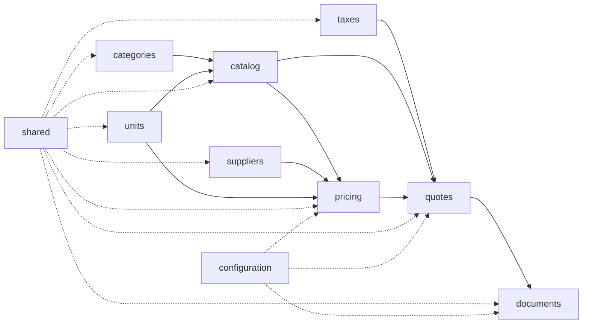
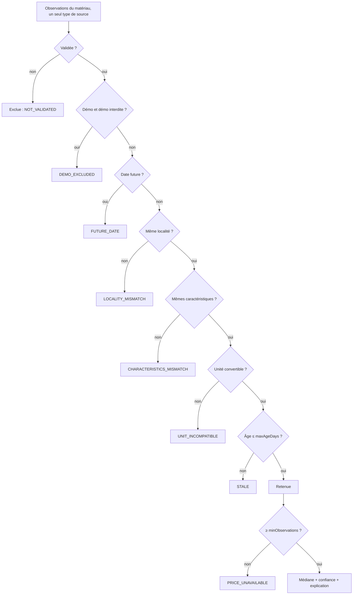
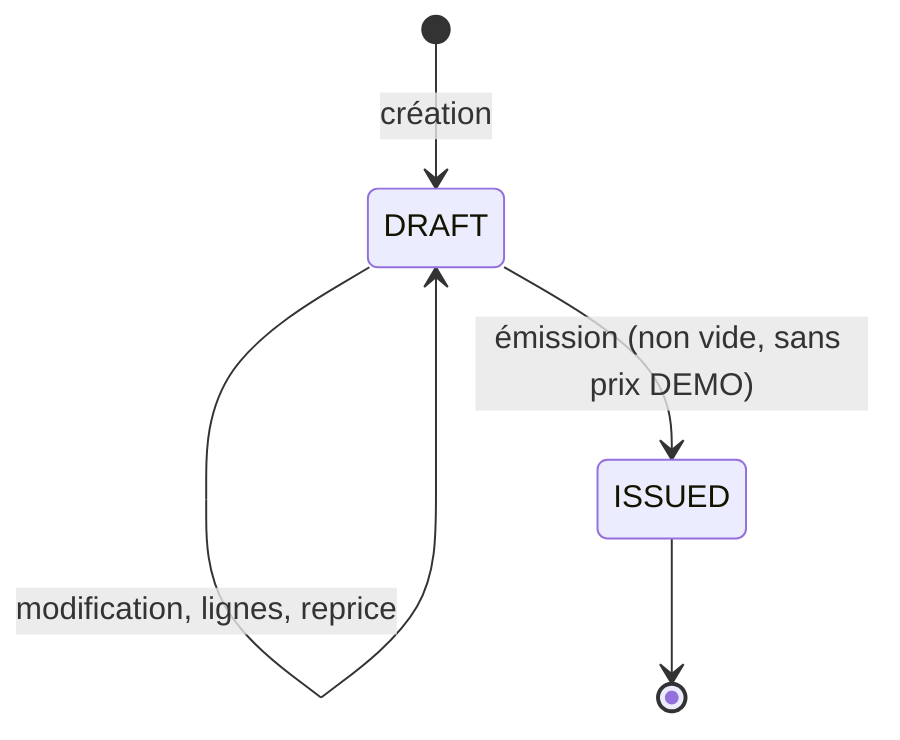

# Architecture

Microservice unique (Spring Boot 4.1.2, Java 21) organisé en modules métier sous `com.nasimmobilier.devis`.

Aucun cycle : `catalog` ne connaît pas `pricing` (le prix d'un matériau s'obtient via `/api/materials/{id}/price-resolution`).

Chaque module : `domain` (entités, repositories, règles) / `application` (services = cas d'usage, DTO en `record`,
frontières `@Transactional`) / `presentation` (contrôleurs REST + OpenAPI). `documents/infrastructure` contient les
adaptateurs PDF et DOCX.

## Choix assumés
- Les entités JPA servent aussi de modèle de domaine et les repositories étendent `JpaRepository` (pas de double modèle
  de persistance). À séparer si le domaine se complexifie.
- Pas d'interfaces de ports pour les renderers : une seule implémentation chacun.
- `PriceSelector` et `PricingEngine` sont des fonctions **pures** (sans Spring ni I/O), testées unitairement.
- Aucune sécurité (hors périmètre).

## Sélection des prix (`pricing`)

- `COMMERCIAL` et `ADMINISTRATIVE_REFERENCE` ne sont jamais mélangés : une résolution ne lit qu'un type (défaut `COMMERCIAL`, imposé aux devis).
- Observations append-only ; seul le statut évolue (`PENDING → VALIDATED | REJECTED`).
- Prix par unité du matériau = prix observé ÷ (nombre d'unités du matériau par unité de vente). Conversions : table `unit_conversions`, sens inverse déduit, `t → kg = 1000` migré.
- Médiane : valeur centrale, ou moyenne des deux centrales si nombre pair ; arrondi HALF_UP à 2 décimales.
- Confiance : `HIGH` si ≥ `highConfidenceMinObservations`, ≥ 2 fournisseurs et écart (max−min)/médiane ≤ `highConfidenceMaxSpreadPercent` ; `MEDIUM` si ≥ 2 observations de ≥ 2 fournisseurs ; sinon `LOW`.
- Prix de démonstration (`demo = true`) : utilisables seulement si `app.pricing.include-demo=true` ; la ligne et le devis sont alors marqués, et le devis **ne peut pas être émis**.

## Calcul d'un devis (`PricingEngine`)

1. total ligne = quantité × prix unitaire (HALF_UP, 2 décimales)
2. sous-total HT = Σ lignes
3. remise = % appliqué à chaque groupe fiscal, **avant** taxe
4. transport = ajouté après remise (jamais remisé), HT
5. taxe par groupe = (lignes − remise + transport du groupe) × taux ; aucun taux ⇒ aucune taxe
6. total TTC = net HT + Σ taxes

Aucun taux n'est jamais supposé. Un taux (`tax_rates`) doit être créé puis validé (`POST /api/tax-rates/{code}/validate`) avant usage ; chaque ligne copie code/libellé/taux ; la ventilation fiscale est stockée dans `quote_taxes`.

## Snapshots et ACID
- `quote_lines` copie désignation, unité, prix, confiance et justification du prix, taxe ; `quotes` copie l'identité de l'entreprise. Un changement de catalogue, de prix, de taux ou de configuration ne modifie jamais un devis existant ; le re-calcul n'a lieu que sur demande explicite (`/reprice`) et uniquement sur un brouillon.
- Chaque cas d'usage de `QuoteService` = une transaction : création du devis, de ses lignes, de sa ventilation fiscale, de l'historique et du numéro sont atomiques (rollback complet en cas d'échec).
- Numéro `DEV-AAAA-000123` dérivé de l'identifiant (identity) dans la transaction de création (l'année est celle de la création du brouillon, pas de l'émission) ; unicité garantie par contrainte SQL.
- Concurrence : `@Version` sur `quotes` → HTTP 409 en cas de modification concurrente.
- Les exports PDF/DOCX ne s'exécutent pas dans une transaction : le devis est lu dans une transaction `readOnly` courte, puis rendu hors transaction.
- Contraintes SQL : `CHECK` (quantités, prix, pourcentages, statuts), `UNIQUE`, clés étrangères, index de recherche.

## Suppression douce
`quotes` et `quote_templates` portent `deleted_at` (migration V4) ; `@SQLRestriction("deleted_at is null")` masque ces lignes dans toutes les requêtes JPA. Seul un devis `DRAFT` peut être supprimé ; les enfants (lignes, taxes, historique) ne sont pas touchés.

## Statuts d'un devis

`ISSUED` est immuable (422 sur toute modification). Chaque transition est tracée dans `quote_status_history`.

## Exports
PDF A4 : Thymeleaf (`templates/quotes/quote.html`) → OpenHTMLtoPDF ; en-tête de tableau répété sur chaque page, numérotation « Page x / y », logo, signature et cachet. DOCX : Apache POI, vrais tableaux Word (en-tête répété). Les deux sont dérivés du seul `QuoteResponse` (snapshot) ; seul le logo est relu à l'export.

## Tests PostgreSQL
`QuoteDbContractPostgresTest` (6 tests, Testcontainers, PostgreSQL 16) rejoue le contrat de `QuoteDbContractTest` sur un vrai
PostgreSQL. Exécuté si Docker est joignable (local ou CI), ignoré sinon. Le job `build` de GitHub Actions les exécute à
chaque PR vers `main`.

## Démarrage
`DatabaseCredentialsCheck` refuse de démarrer si `DB_USER`/`DB_PASSWORD` sont absents ou vides pour une URL PostgreSQL
(sans lui, Spring conserve le texte littéral `${DB_USER}`).

## Non fait / limites
- Signature électronique, envoi par mail, restauration d'éléments supprimés. La suppression douce ne couvre que les devis brouillon et les modèles (pas catalogue, fournisseurs, etc.).
- Le logo n'est pas snapshotté.
